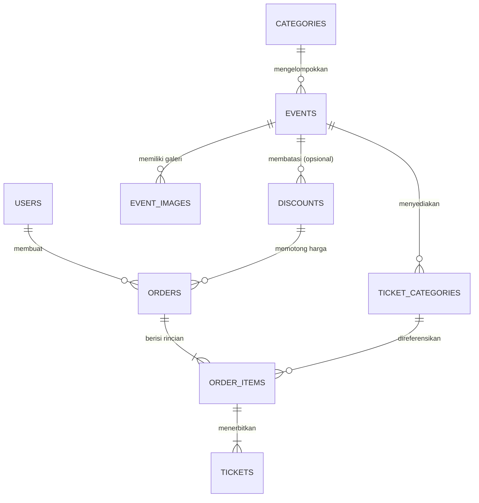

# 1. Arsitektur & Struktur Kode

Dokumen ini menjelaskan bagaimana proyek **Get To Ticketing** diorganisasikan, bagaimana alur kerja *request* di Laravel, serta bagaimana tabel-tabel di database saling berelasi.

---

## 1.1 Pola Arsitektur (Bagaimana Kode Dipisahkan)

Aplikasi ini mengikuti pola arsitektur **Service-Oriented MVC** ala Laravel agar kode tetap rapi, mudah dibaca, dan tidak menumpuk di satu file:

1. **Routes (`routes/web.php` & `routes/console.php`)**
   - Bertugas sebagai "peta jalan". Route dibuat tipis (*thin routes*), hanya menghubungkan URL (seperti `/events/{event:slug}` atau `/gate/check-in`) ke Controller yang sesuai dan memasang *middleware* (seperti `auth`, `AdminOnly`, atau *rate limiter* `throttle`).
2. **Middleware & Policies (`app/Http/Middleware/` & `app/Policies/`)**
   - Bertugas sebagai "penjaga pintu". Memeriksa apakah pengguna sudah login, apakah dia berhak melihat pesanan orang lain (`OrderPolicy`), apakah dia seorang Admin (`AdminOnly`), serta menyuntikkan header keamanan (`SecurityHeaders`) dan bahasa aktif (`SetLocale`).
3. **Form Requests (`app/Http/Requests/`)**
   - Bertugas memeriksa validitas input form sebelum masuk ke logika utama (misal: `CheckoutRequest`, `EventRequest`, `TicketCategoryRequest`, `LoginRequest`, `RegisterRequest`).
4. **Controllers (`app/Http/Controllers/`)**
   - Bertugas menerima input yang sudah valid, memanggil *Service* atau *Model*, lalu mengembalikan halaman Blade atau respons JSON.
5. **Services (`app/Services/BookingService.php`)**
   - **Jantung bisnis aplikasi.** Semua aturan kritis seperti pengurangan stok tiket, penguncian baris database (`lockForUpdate`), pembatalan pesanan kedaluwarsa, pembuatan kode tiket, dan validasi *gate check-in* disimpan di sini agar bisa dipanggil oleh berbagai Controller maupun perintah terjadwal (*scheduler*).
6. **Models (`app/Models/`)**
   - Representasi tabel database menggunakan Eloquent ORM beserta relasinya.
7. **Views & Assets (`resources/views/`, `resources/css/`, `resources/js/`, `public/`)**
   - Antarmuka pengguna menggunakan komponen Blade, styling Tailwind CSS 4 + custom CSS (`app.css`), skrip interaktif (`resources/js/app.js`), dan mesin pemindai gate mandiri (`public/gate-scanner.js`).

---

## 1.2 Peta Folder Penting

```text
get-to-ticketing/
├── app/
│   ├── Http/
│   │   ├── Controllers/
│   │   │   ├── Admin/                  # Controller khusus panel Admin
│   │   │   │   ├── BuyerResetController.php      # Reset data transaksi pembeli
│   │   │   │   ├── DashboardController.php       # Statistik & daftar pelanggan + ekspor CSV
│   │   │   │   ├── DiscountController.php        # CRUD kode promo/diskon
│   │   │   │   ├── EventController.php           # CRUD konser, banner, & galeri
│   │   │   │   ├── TicketCategoryController.php  # CRUD kategori tiket (VIP, Regular, dll)
│   │   │   │   └── UserController.php            # Kelola akun pengguna & ubah role
│   │   │   ├── AuthController.php          # Login, Register, Logout
│   │   │   ├── CatalogController.php       # Halaman utama katalog & detail konser
│   │   │   ├── DiscountCheckController.php # Endpoint AJAX cek kode promo di halaman detail
│   │   │   ├── GateCheckInController.php   # Halaman scanner, API check-in, manifest, & sync
│   │   │   ├── LocaleController.php        # Ganti bahasa ID / EN
│   │   │   ├── OrderController.php         # Checkout, riwayat My Tickets, detail order, batal
│   │   │   ├── PasswordResetController.php # Lupa sandi & atur ulang kata sandi
│   │   │   ├── ProfileController.php       # Edit profil, ganti sandi, hapus akun
│   │   │   ├── TicketPdfController.php     # Unduh PDF E-Ticket & kirim ulang email
│   │   │   └── XenditPaymentController.php # Buat invoice Xendit, cek status, & webhook
│   │   ├── Middleware/
│   │   │   ├── AdminOnly.php               # Hanya izinkan role 'admin'
│   │   │   ├── SecurityHeaders.php         # Header CSP, izin kamera, X-Frame-Options
│   │   │   └── SetLocale.php               # Terapkan bahasa dari session pengguna
│   │   └── Requests/                       # Validasi input form (Checkout, Event, Auth, dll)
│   ├── Mail/
│   │   └── OrderPaidMail.php               # Email bukti lunas + lampiran PDF E-Ticket
│   ├── Models/                             # Model Eloquent (User, Event, Order, Ticket, dll)
│   ├── Policies/
│   │   └── OrderPolicy.php                 # Pastikan pembeli hanya bisa buka pesanannya sendiri
│   └── Services/
│       ├── BookingService.php              # Logika utama checkout, stok, bayar, & gate check-in
│       └── XenditService.php               # Komunikasi HTTP ke API Xendit
├── database/
│   ├── migrations/                         # Definisi struktur tabel PostgreSQL
│   └── seeders/                            # Data awal konser, kategori, & akun demo
├── lang/
│   ├── id.json                             # Kamus terjemahan Bahasa Indonesia (8 modul terurut)
│   └── en.json                             # Kamus terjemahan Bahasa Inggris (8 modul terurut)
├── public/
│   ├── gate-scanner.js                     # Mesin operasional Gate Scanner (kamera, PDA, offline)
│   ├── jsqr.min.js                         # Library pembaca QR code lokal (bebas internet)
│   └── theme.js                            # Pengatur instan Light/Dark mode tanpa kedip (FOUC)
├── resources/
│   ├── css/app.css                         # Desain visual utama & komponen UI
│   ├── js/app.js                           # Interaktivitas katalog, stepper tiket, diskon, tab
│   └── views/                              # Seluruh template halaman Blade
└── tests/Feature/                          # 83 pengujian otomatis fitur aplikasi
```

---

## 1.3 Skema Database & Relasi Model

Database menggunakan **PostgreSQL**. Seluruh nilai uang/harga disimpan sebagai **bilangan bulat Rupiah (`bigint` / `integer`)** untuk menghindari kesalahan pembulatan desimal.

### Diagram Relasi Entitas (ERD)



### Penjelasan Masing-Masing Model (`app/Models/`)

1. **`User` (`users`)**
   - Menyimpan data akun pengguna (`name`, `username`, `email`, `password`, `role`).
   - Memiliki 3 kemungkinan nilai `role`:
     - `customer`: Pembeli biasa (memesan tiket, melihat riwayat tiket).
     - `gate_staff`: Panitia lapangan (hanya bisa membuka halaman Gate Scanner untuk memindai tiket dan sinkronisasi antrean).
     - `admin`: Pengelola penuh (akses Dashboard Admin, CRUD event/tiket/diskon/user, pengaturan kunci sistem gate, serta reset data pembeli).

2. **`Category` (`categories`) & `Event` (`events`)**
   - `Category` mengelompokkan jenis konser (misal: *Pop*, *Indie & Folk*, *Jazz & Soul*, *Rock*, *Festival*).
   - `Event` menyimpan informasi konser (`title`, `slug`, `summary`, `description`, `venue`, `city`, `address`, `start_time`, `end_time`, `banner_path`, `status` [`draft`, `published`, `archived`], `is_featured`).
   - `EventImage` menyimpan foto-foto galeri tambahan untuk satu konser.

3. **`TicketCategory` (`ticket_categories`)**
   - Menyimpan jenis tiket di dalam suatu konser (misal: *VIP*, *Festival / CAT 1*, *Regular*).
   - Memiliki kolom penting:
     - `price`: Harga satuan tiket (Rupiah).
     - `capacity`: Total kuota awal yang disediakan penyelenggara.
     - `stock`: Sisa tiket yang masih bisa dibeli saat ini.
     - `max_per_order`: Batas beli maksimal per transaksi untuk kategori tersebut.

4. **`Discount` (`discounts`)**
   - Menyimpan aturan kode promo (`code`, `name`, `type` [`percent` atau `fixed`], `value`, `min_purchase`, `max_discount`, `quota`, `used_count`, `event_id`, `starts_at`, `expires_at`, `is_active`).
   - Jika `event_id` bernilai `null`, maka kode diskon berlaku global untuk semua konser. Jika diisi, hanya berlaku untuk konser tersebut.

5. **`Order` (`orders`) & `OrderItem` (`order_items`)**
   - `Order` adalah kepala transaksi pemesanan (`number` [UUID unik], `user_id`, `checkout_key`, `status` [`pending`, `paid`, `cancelled`, `expired`], `subtotal`, `discount_id`, `discount_code`, `discount_amount`, `total`, `expires_at`, `paid_at`, serta kolom referensi Xendit).
   - `OrderItem` menyimpan rincian kategori tiket yang dibeli beserta **snapshot data saat dibeli** (`event_title`, `ticket_name`, `event_start_time`, `venue`, `unit_price`, `quantity`, `subtotal`).
   - **Mengapa pakai snapshot di `OrderItem`?** Agar jika suatu hari Admin mengubah nama konser atau menaikkan harga tiket, riwayat nota pesanan pembeli lama **tidak ikut berubah**.

6. **`Ticket` (`tickets`)**
   - Dibuat **hanya setelah pesanan berstatus `paid` (lunas)**. Jika seorang pembeli memesan 3 tiket VIP, maka saat lunas akan dibuat 3 baris di tabel `tickets`.
   - Setiap tiket memiliki `code` (UUID unik 36 karakter), `status` (`active` atau `used`), dan `checked_in_at` (waktu saat tiket di-scan masuk di gate).
   - Model `Ticket` juga memiliki fungsi kriptografi `getHmacSignature()` dan `getQrPayload()` untuk menghasilkan kode QR anti-palsu.

