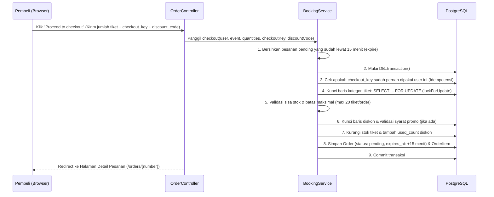

# 2. Alur Checkout, Penguncian Stok & Pembayaran

Dokumen ini membedah bagaimana aplikasi menangani pemesanan tiket, menjaga agar stok tidak pernah minus (*overselling*), memvalidasi diskon, hingga menerbitkan E-Ticket. Seluruh logika inti ini berada di **`app/Services/BookingService.php`**.

---

## 2.1 Diagram Alur Pemesanan (*Checkout Flow*)



---

## 2.2 Bagaimana Pengaman Stok Bekerja (`BookingService::checkout`)

Saat konser populer dibuka, bisa ada banyak pembeli yang menekan tombol *Checkout* di detik yang sama untuk memperebutkan sisa tiket terakhir. Aplikasi ini mencegah masalah tersebut dengan **4 lapis pengaman**:

### 1. Pembersihan Otomatis Sebelum Transaksi (`expire()`)
Sebelum menghitung stok, `BookingService` terlebih dahulu mencari pesanan berstatus `pending` pada konser tersebut yang waktu `expires_at`-nya sudah lewat dari waktu sekarang (`now()`), lalu mengembalikan stoknya ke `ticket_categories`. Dengan begitu, tiket yang ditelantarkan pembeli lain langsung bisa dibeli.

### 2. Idempotensi dengan `checkout_key`
Di form pemesanan (`resources/views/catalog/show.blade.php`), terdapat input tersembunyi:
```html
<input type="hidden" name="checkout_key" value="{{ old('checkout_key', (string) Str::uuid()) }}">
```
Jika koneksi internet pembeli lambat lalu dia menekan tombol *Checkout* berkali-kali (klik ganda), database akan mendeteksi bahwa pasangan `(user_id, checkout_key)` sudah ada di tabel `orders`. Sistem tidak akan memotong stok dua kali, melainkan langsung mengembalikan pesanan yang sudah terbentuk.

### 3. Penguncian Baris Database (`lockForUpdate()`)
Di dalam `DB::transaction()`, kategori tiket diambil dengan perintah:
```php
$categories = $event->ticketCategories()
    ->whereKey($requested->keys())
    ->orderBy('id')
    ->lockForUpdate()
    ->get();
```
Perintah `lockForUpdate()` membuat PostgreSQL mengunci baris kategori tiket tersebut. Jika Pembeli A dan Pembeli B membeli tiket terakhir di milidetik yang sama:
- Pembeli A mengunci baris lebih dulu, mengecek `stock >= qty`, lalu mengurangi stok menjadi `0`.
- Permintaan Pembeli B akan **antre menunggu** sampai transaksi Pembeli A selesai (commit), lalu saat Pembeli B membaca baris tersebut, stok sudah `0` sehingga Pembeli B mendapat pesan validasi *"Not enough stock for..."* secara aman.

### 4. Snapshot Harga & Nama Item
Saat membuat `OrderItem`, sistem menyalin `event_title`, `ticket_name`, `event_start_time`, `venue`, dan `unit_price` ke tabel `order_items`. Jika besok Admin mengubah harga tiket VIP dari Rp500.000 menjadi Rp750.000, pesanan yang sudah dibuat tetap tercatat Rp500.000.

---

## 2.3 Cara Kerja Diskon & Kode Promo

Validasi diskon terjadi di **dua tempat** agar pengalaman pengguna nyaman sekaligus aman:

1. **Pengecekan Interaktif via AJAX (`DiscountCheckController::check`)**
   - Saat pembeli mengetik kode promo di halaman detail konser dan menekan tombol **Apply**, JavaScript (`resources/js/app.js`) mengirim request POST ke `/discounts/check`.
   - Controller memanggil `Discount::validateForSubtotal($subtotal, $eventId)` untuk memeriksa:
     - Apakah kode aktif (`is_active`)?
     - Apakah kode khusus untuk konser tertentu (`event_id`)?
     - Apakah sudah masuk tanggal mulai (`starts_at`) dan belum kedaluwarsa (`expires_at`)?
     - Apakah kuota pemakaian (`used_count < quota`) masih tersedia?
     - Apakah subtotal tiket mencapai minimal pembelian (`min_purchase`)?
   - Jika valid, UI langsung menampilkan rincian potongan harga di layar.

2. **Validasi Ulang Saat Checkout (`BookingService::checkout`)**
   - Kita tidak pernah mempercayai angka perhitungan dari browser begitu saja. Saat form dikirim ke server, `BookingService` kembali mengunci baris diskon dengan `Discount::where('code', ...)->lockForUpdate()->first()`, memvalidasi ulang syaratnya terhadap subtotal asli di server, menghitung potongan (`calculateDeduction`), dan menambah `used_count` diskon sebesar 1.

---

## 2.4 Pembatalan & Kedaluwarsa Pesanan (`BookingService::release`)

Setiap pesanan baru memiliki masa tunggu **15 menit** (`expires_at = now()->addMinutes(15)`).
Jika pesanan dibatalkan secara manual oleh pembeli (`OrderController::cancel`) atau melewati batas 15 menit (`BookingService::expire` yang juga dijadwalkan setiap menit di `routes/console.php`):

1. Fungsi `release($order, 'cancelled' | 'expired')` dijalankan di dalam transaksi database.
2. Baris `Order`, `TicketCategory`, dan `Discount` dikunci dengan `lockForUpdate()`.
3. Kuota tiket dikembalikan (`$category->increment('stock', $item->quantity)`), tetapi dijaga dengan `min($category->capacity, ...)` agar stok tidak pernah melebihi kapasitas awal.
4. Jika pesanan memakai kode diskon, maka `used_count` diskon dikurangi 1 sehingga kupon promo kembali bisa dipakai.

---

## 2.5 Penyelesaian Pembayaran & Penerbitan Tiket (`BookingService::pay`)

Aplikasi menyediakan **2 jalur pembayaran** pada halaman detail pesanan (`resources/views/orders/show.blade.php`):

### Jalur A: Simulasi Instan Lokal (`OrderController::pay`)
Digunakan untuk demonstrasi portofolio atau pengujian lokal tanpa keluar dari website. Ketika tombol *"Simulate instant payment"* diklik, controller langsung memanggil `$bookingService->pay($order)`.

### Jalur B: Integrasi Xendit Sandbox (`XenditPaymentController`)
1. Pembeli menekan tombol bayar via Xendit -> `XenditService::createInvoice()` mengirim request ke API Xendit (`https://api.xendit.co/v2/invoices`) dan menyimpan `xendit_invoice_id` serta `xendit_invoice_url` di pesanan.
2. Pembeli menyelesaikan pembayaran di halaman Xendit Simulator.
3. Ketika status di Xendit menjadi `PAID` atau `SETTled` (baik melalui *webhook callback* `/xendit/webhook` maupun tombol *Check Payment Status* `/orders/{order}/xendit/check`), sistem memanggil `$bookingService->pay($order)`.

### Apa yang Terjadi di Dalam `BookingService::pay($order)`?
1. Memastikan pesanan masih berstatus `pending` dan belum melewati `expires_at`.
2. Mengubah status pesanan menjadi `paid` dan mencatat waktu `paid_at = now()`.
3. **Menerbitkan Tiket (`tickets`):** Melakukan perulangan sebanyak jumlah tiket yang dibeli pada setiap `OrderItem`, lalu membuat baris di tabel `tickets` dengan kode `Str::uuid()` unik dan status `active`.
4. **Mengirim Email Konfirmasi & PDF (`OrderPaidMail`):** Membuat file PDF E-Ticket di memori dan mengirimkannya ke alamat email pembeli. Pengiriman email dibungkus blok `try-catch` (`report($e)`) agar jika SMTP email lokal sedang mati, transaksi pembayaran pembeli tetap sukses dan tidak gagal.

---

## 2.6 Unduh PDF E-Ticket & Tab Riwayat "My Tickets"

- **Unduh PDF (`TicketPdfController::download`):** Menggunakan `barryvdh/laravel-dompdf` untuk merender view `resources/views/tickets/pdf.blade.php` menjadi dokumen PDF siap cetak yang memuat kode QR SVG dari masing-masing tiket.
- **Tab Filter di "My Tickets" (`resources/views/orders/index.blade.php`):**
  Agar riwayat tiket pengguna tetap rapi meskipun sudah digunakan bertahun-tahun, halaman *My Tickets* membagi daftar pesanan ke dalam 3 tab interaktif:
  1. **All Orders (Semua Pesanan):** Menampilkan seluruh riwayat transaksi.
  2. **Active Tickets (Tiket Aktif):** Hanya menampilkan pesanan berstatus `paid` atau `pending` yang jadwal konsernya **belum lewat**.
  3. **Past Events (Riwayat Tiket Lalu):** Mengarsipkan konser yang sudah selesai berlangsung, pesanan yang dibatalkan (`cancelled`), atau kedaluwarsa (`expired`).

