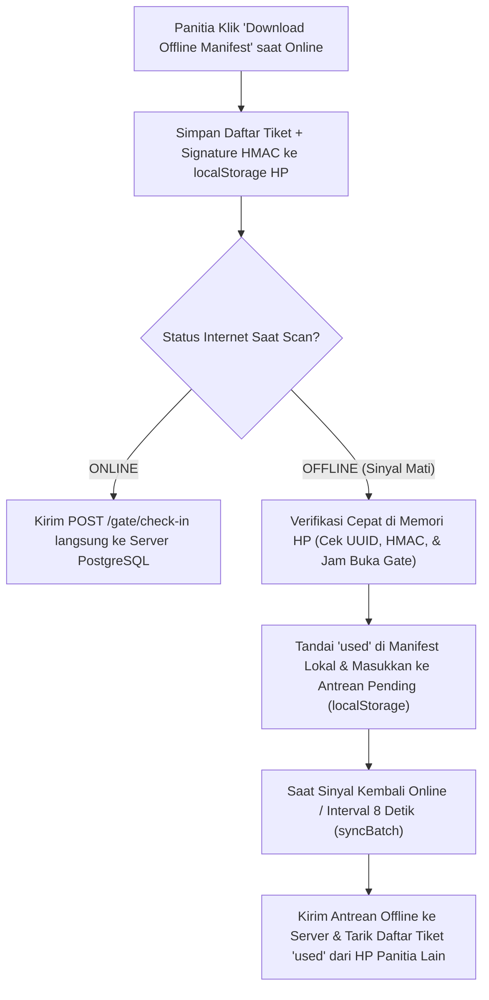

# 3. Sistem Gate Scanner & Sinkronisasi Offline

Dokumen ini menjelaskan cara kerja halaman **Gate Ticket Scanner** (`resources/views/gate/scan.blade.php`), mesin JavaScript mandiri di `public/gate-scanner.js`, serta endpoint backend di `GateCheckInController.php` dan `BookingService::checkIn()`.

Sistem ini dirancang khusus agar panitia lapangan (`gate_staff` maupun `admin`) tetap bisa memindai tiket penonton dengan cepat menggunakan kamera HP/laptop maupun alat *PDA laser scanner*, baik saat koneksi internet lancar (**Online**) maupun saat sinyal di lokasi konser mati total (**100% Offline**).

---

## 3.1 Keamanan QR Code Anti-Pemalsuan (HMAC-SHA256)

Jika sebuah QR Code hanya berisi kode UUID biasa, orang jahat bisa mencoba menebak-nebak UUID atau memodifikasi isi QR. Untuk mencegah hal tersebut, aplikasi ini menggunakan **tanda tangan kriptografis HMAC-SHA256** (`app/Models/Ticket.php`):

1. **Cara Pembuatan Payload QR (`Ticket::getQrPayload`)**
   Setiap tiket memiliki `code` (UUID 36 karakter). Sistem menggabungkan UUID tersebut dengan *secret key* aplikasi (`APP_KEY` di `.env`) menggunakan algoritma `hash_hmac('sha256', $code, $appKey)` dan mengambil 16 karakter pertamanya sebagai tanda tangan digital (*signature*).
   Format isi QR Code menjadi:
   ```text
   47f734b1-e2ea-4377-bb41-30eba959125d.a9f3c1e84b20d712
   |------------ UUID Tiket ------------|.|-- HMAC 16-char --|
   ```

2. **Cara Verifikasi Saat Di-Scan (`Ticket::verifySignature`)**
   Ketika QR dipindai di pintu masuk:
   - Sistem memisahkan bagian sebelum titik (`UUID`) dan sesudah titik (`Signature`).
   - Sistem menghitung ulang HMAC dari UUID tersebut dan membandingkannya menggunakan fungsi waktu-konstan `hash_equals($expected, $signature)`.
   - Jika satu huruf saja diubah oleh pemalsu, tanda tangan tidak akan cocok dan layar langsung menampilkan peringatan merah **`FORGED TICKET (SIGNATURE MISMATCH)`**.

3. **Penanganan Input UUID Tidak Valid (Guard `SQLSTATE[22P02]`)**
   Karena kolom `code` di PostgreSQL bertipe native `uuid`, jika seseorang mengetik kode sembarang yang bukan format UUID 36 karakter (misal kurang 1 angka atau salah scan barcode makanan), query langsung ke PostgreSQL akan memicu error `SQLSTATE[22P02]`.
   Oleh karena itu, sebelum menyentuh database, `BookingService::checkIn()` memeriksa `Str::isUuid($code)` terlebih dahulu. Jika formatnya bukan UUID valid, sistem langsung menolak dengan pesan ramah tanpa membuat database error.

---

## 3.2 Empat Metode Input Pemindaian

Mesin `public/gate-scanner.js` mendukung 4 cara memasukkan tiket sekaligus:

1. **Kamera Live (HP / Webcam Laptop)**
   - Menggunakan API browser `navigator.mediaDevices.getUserMedia` untuk menampilkan video kamera ke elemen `<canvas>`, lalu setiap *frame* dibaca oleh library lokal **`public/jsqr.min.js`**.
   - Dilengkapi tombol **Switch Camera** (depan/belakang/webcam USB) dan **Turn Off/On Camera**.
2. **Unggah Gambar QR (*Upload QR Image*)**
   - Jika lensa kamera bermasalah, panitia bisa memilih file tangkapan layar (*screenshot*) tiket untuk langsung didekode oleh `jsQR`.
3. **Alat Fisik PDA / Laser Barcode Scanner**
   - Alat scanner fisik bekerja seperti *keyboard* yang mengetikkan karakter sangat cepat (< 120ms antar-karakter) lalu diakhiri tombol `Enter`.
   - `gate-scanner.js` memiliki *Global Keystroke Listener* yang menangkap ketikan cepat tersebut secara otomatis meskipun kursor tidak sedang berada di kotak input.
4. **Input Manual & Tabel Manifest (dengan Konfirmasi 2 Langkah)**
   - Panitia dapat mengetik/menempel kode tiket di kolom manual, atau mengklik tombol **Scan This Ticket →** pada tabel *Event Ticket Manifest*.

---

## 3.3 Pengaturan Gate & Kunci Jendela Waktu (`start_time`)

Khusus pengguna dengan peran **`admin`** (disembunyikan untuk `gate_staff`), terdapat panel **Gate System & Time Control**:

1. **Saklar Utama Sistem Gate (`system_active`)**
   - Admin dapat membuka atau mengunci seluruh aktivitas scan untuk event yang dipilih. Jika dikunci, siapapun yang mencoba scan akan ditolak dengan status `GATE LOCKED`.
2. **Jendela Waktu Buka Gate (`time_lock_enabled` & `hours_before_start`)**
   - Mengikuti jadwal `start_time` konser. Admin dapat memilih:
     - **Free Scan Anytime:** Bebas scan kapan saja (cocok saat latihan/pengujian).
     - **Lock H-1 (24 Jam):** Gate baru bisa menerima scan 24 jam sebelum konser dimulai.
     - **Lock D-Day (6 Jam):** Gate baru terbuka 6 jam sebelum jadwal mulai.
     - **Custom Hours (H-X Jam):** Admin menentukan sendiri berapa jam sebelum acara gate dibuka.
   - Jika penonton datang terlalu cepat (misal konser tanggal 16 tetapi di-scan tanggal 12 saat kunci H-1 aktif), sistem menolak tiket dengan informasi jam berapa gate baru dibuka, **tanpa menghanguskan tiket tersebut**.

---

## 3.4 Cara Kerja Mode Offline & Sinkronisasi 2 Arah (*2-Way Multi-Device Sync*)



### Tahap 1: Unduh Manifest (`GET /gate/manifest/{event}`)
Saat masih ada koneksi internet, panitia memilih event konser (otomatis mengunduh di latar belakang atau klik tombol **Download Offline Manifest**). Server mengirimkan daftar tiket lunas beserta nama pembeli (`holder`), kategori, status, dan tanda tangan `signature` HMAC untuk disimpan di `localStorage` browser (`gate_manifest_v1_{eventId}`).

### Tahap 2: Memindai Tanpa Internet (*Zero-Latency Offline Scan*)
Ketika internet terputus (indikator berubah menjadi kuning **`OFFLINE`**):
- Saat tiket di-scan, `gate-scanner.js` tidak gagal, melainkan langsung memeriksa data di `localStorage` HP tersebut.
- Memeriksa apakah kode terdaftar, apakah tanda tangan HMAC cocok, apakah sistem gate tidak dikunci, dan apakah tiket belum pernah di-scan.
- Jika valid, tiket langsung ditandai `used` di memori lokal dan dicatat ke antrean `gate_pending_sync_v1`.

### Tahap 3: Sinkronisasi 2 Arah & Deteksi Konflik (`POST /gate/sync-batch`)
Setiap **8 detik sekali** (ketika online) atau saat tombol **Sync Offline Tickets** diklik:
1. **Arah 1 (Upload):** HP mengirimkan daftar tiket yang di-scan selama offline ke server untuk disimpan permanen ke PostgreSQL.
2. **Deteksi Konflik Multi-Perangkat:** Bagaimana jika HP Panitia A (offline) dan HP Panitia B (offline) memindai tiket yang sama di pintu berbeda? Saat keduanya kembali online dan melakukan sinkronisasi, perangkat kedua akan menerima laporan `conflicts` dari server dan menampilkan peringatan **`MULTI-DEVICE CONFLICT DETECTED!`** beserta informasi bahwa tiket tersebut sudah lebih dulu masuk di pintu lain.
3. **Arah 2 (Download Delta):** Server mengirimkan kembali daftar seluruh kode tiket yang sudah berstatus `used` terbaru dari semua pintu agar manifest lokal di setiap HP panitia selalu mutakhir.

---

## 3.5 Fitur Keamanan UX Tambahan di Halaman Gate Scanner

1. **Tabel Event Ticket Manifest yang Mudah Dibaca**
   - Kolom pertama menampilkan **Nama Pembeli Tiket (`Attendee`)** dengan huruf tebal agar mudah dicari secara visual.
   - Kolom kedua menampilkan **Kode Tiket UUID yang disingkat** (misal `47f734b1…9125`) dengan *tooltip* kode lengkap saat kursor diarahkan.
2. **Modal Konfirmasi 2 Langkah pada Quick Action**
   - Tombol *"Scan This Ticket →"* di tabel manifest tidak langsung mengeksekusi check-in (mencegah jari panitia tidak sengaja menyentuh tombol saat menggeser layar HP).
   - Mengklik tombol tersebut akan membuka **Modal Konfirmasi** berisi Nama Pembeli, Kategori, Kode Tiket, serta peringatan merah jika tiket tersebut sebenarnya sudah pernah masuk. Check-in baru diproses setelah tombol hijau **"Ya, Masuk Gate →"** ditekan.
3. **Toggle Simpan Riwayat Scan (*Keep on reload*)**
   - Secara bawaan (*default OFF*), tabel *Recent Scan History* hanya menyimpan riwayat sesi berjalan dan akan bersih kembali saat halaman di-refresh.
   - Jika panitia menyalakan saklar **Keep on reload (Simpan saat refresh)**, sistem akan menyimpan hingga **30 riwayat scan terakhir** di `localStorage` (`gate_recent_scans_{eventId}`) sehingga daftar riwayat tidak hilang meskipun browser tidak sengaja ter-refresh.
4. **Efek Suara Web Audio Synthesizer**
   - Bunyi *beep* sukses (nada tinggi ganda) dan gagal (nada rendah *buzz*) dihasilkan langsung menggunakan `window.AudioContext` bawaan browser, sehingga tidak membutuhkan file `.mp3` eksternal dan 100% bekerja saat offline.

