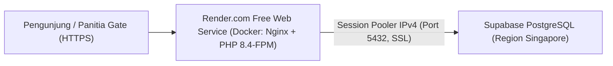

# 05 — Panduan Deployment Cloud: Database Supabase & Web Hosting Gratis (Render.com)

Dokumen ini menjelaskan langkah demi langkah cara mengunggah database PostgreSQL ke **Supabase Cloud** dan men-deploy aplikasi **Get To Ticketing** ke **Render.com** secara gratis menggunakan kontainer Docker yang sudah disiapkan di proyek ini.

---

## 1. Gambaran Arsitektur Deployment



- **Hosting Aplikasi (`Render.com`)**: Menjalankan `Dockerfile` multi-stage yang mengompilasi aset Vite (`npm run build`) dan menjalankan PHP 8.4-FPM + Nginx.
- **Database Cloud (`Supabase`)**: Menyediakan PostgreSQL terkelola gratis. Koneksi dilakukan melalui **Session Pooler (Port 5432)** agar kompatibel dengan jaringan IPv4 Render serta mendukung penuh transaksi `lockForUpdate()` dan prepared statements Laravel.

---

## 2. File Konfigurasi Deployment di Proyek

Seluruh file infrastruktur Docker telah disiapkan di root proyek:
- **`Dockerfile`**: Multi-stage build (Stage 1: Node 22 untuk `npm run build`, Stage 2: PHP 8.4-FPM Alpine + Nginx + ekstensi `pdo_pgsql`, `gd`, `intl`, `bcmath`, `zip`, `opcache`).
- **`docker/nginx.conf.template`**: Konfigurasi server blok Nginx yang membaca variabel `${PORT}` secara dinamis.
- **`docker/entrypoint.sh`**: Skrip startup otomatis untuk membuat symlink `storage:link`, melakukan cache konfigurasi/route/view, menjalankan migrasi otomatis jika `RUN_MIGRATIONS=true`, dan menyalakan PHP-FPM + Nginx.
- **`.dockerignore`**: Mencegah folder berat atau sensitif (`node_modules`, `vendor`, `.env`, `storage/app/private/postgres`) ikut terunggah ke image Docker.
- **`render.yaml`**: Blueprint konfigurasi otomatis untuk Render.com.
- **`bootstrap/app.php`**: Dilengkapi `$middleware->trustProxies(at: '*');` agar Laravel mengenali skema `https://` di balik reverse proxy Render.

---

## 3. Langkah demi Langkah: Setup Database di Supabase

1. Buka [https://supabase.com](https://supabase.com) dan masuk dengan akun GitHub.
2. Klik **New Project**:
   - **Name**: `get-to-ticketing`
   - **Database Password**: Buat password yang kuat dan **simpan di catatan Anda**.
   - **Region**: Pilih `Southeast Asia (Singapore)` (`ap-southeast-1`) agar latensi paling cepat dari Indonesia.
3. Setelah project selesai dibuat (~1–2 menit), klik tombol **Connect** di bagian atas dashboard Supabase:
   - Pilih tab **ORMs** -> **Laravel** (atau lihat bagian **Session Pooler**).
   - Gunakan kredensial **Session Pooler (IPv4 Compatible)**:
     - `DB_HOST`: `aws-0-ap-south-1.pooler.supabase.com`
     - `DB_PORT`: `5432`
     - `DB_DATABASE`: `postgres`
     - `DB_USERNAME`: `postgres.sdmaewkjxylihuofuevc`
     - `DB_PASSWORD`: `<password-database-anda>`
     - `DB_SSLMODE`: `require`

### Cara Upload / Migrasi Skema & Data Awal dari Lokal ke Supabase (Opsi Instan dari PowerShell)

Anda bisa menjalankan migrasi langsung dari terminal lokal ke Supabase untuk memastikan database cloud terisi sebelum aplikasi di-deploy:

1. Buka terminal PowerShell di folder proyek dan jalankan perintah berikut (ganti `<PASSWORD_SUPABASE>` dengan kata sandi database Anda):
   ```powershell
   $env:DB_HOST="aws-0-ap-south-1.pooler.supabase.com"; $env:DB_PORT="5432"; $env:DB_DATABASE="postgres"; $env:DB_USERNAME="postgres.sdmaewkjxylihuofuevc"; $env:DB_PASSWORD="<PASSWORD_SUPABASE>"; $env:DB_SSLMODE="require"; php artisan migrate --seed --force
   ```
2. Setelah selesai, cek tab **Table Editor** di dashboard Supabase. Anda akan melihat tabel `events`, `ticket_categories`, `users`, `discounts`, dll. sudah terbuat dan berisi data awal!
3. Tutup jendela PowerShell tersebut atau restart terminal agar environment lokal Anda kembali membaca `.env` lokal (`127.0.0.1:5433`).

---

## 4. Langkah demi Langkah: Deploy ke Render.com (Gratis)

1. **Push Kode ke GitHub**:
   Pastikan seluruh perubahan termasuk `Dockerfile`, `docker/`, dan `render.yaml` sudah di-commit dan di-push ke repository GitHub Anda:
   ```powershell
   git add .
   git commit -m "Prepare Docker and Render deployment configuration"
   git push origin main
   ```

2. **Buat Web Service di Render**:
   - Buka [https://dashboard.render.com](https://dashboard.render.com) dan login menggunakan GitHub.
   - Klik **New +** -> **Web Service**.
   - Pilih repository **`get-to-ticketing`**.
   - Isi pengaturan dasar:
     - **Name**: `get-to-ticketing`
     - **Region**: `Singapore (Southeast Asia)`
     - **Runtime**: `Docker`
     - **Instance Type**: `Free`

3. **Isi Environment Variables di Render**:
   Pada bagian **Environment Variables**, tambahkan daftar berikut:

   | Key | Nilai (Value) |
   | :--- | :--- |
   | `APP_NAME` | `The Get To` |
   | `APP_ENV` | `production` |
   | `APP_DEBUG` | `false` |
   | `APP_KEY` | *(Salin nilai `APP_KEY=base64:...` dari file `.env` lokal Anda)* |
   | `APP_URL` | `https://get-to-ticketing.onrender.com` *(sesuaikan dengan URL Render Anda)* |
   | `LOG_CHANNEL` | `stderr` |
   | `DB_CONNECTION` | `pgsql` |
   | `DB_HOST` | `aws-0-ap-southeast-1.pooler.supabase.com` |
   | `DB_PORT` | `5432` |
   | `DB_DATABASE` | `postgres` |
   | `DB_USERNAME` | `postgres.<project-ref>` |
   | `DB_PASSWORD` | `<password-supabase-anda>` |
   | `DB_SSLMODE` | `require` |
   | `SESSION_DRIVER` | `database` |
   | `CACHE_STORE` | `database` |
   | `QUEUE_CONNECTION` | `sync` |
   | `RUN_MIGRATIONS` | `true` |
   | `RUN_SEEDER` | `true` *(Ubah menjadi `false` setelah deploy pertama selesai agar tidak re-seed berulang)* |

4. **Klik Deploy Web Service**:
   - Render akan membangun image Docker (~3–5 menit).
   - Saat selesai, status akan berubah menjadi **Live** dan aplikasi dapat diakses melalui URL `https://<nama-service>.onrender.com`.

---

## 5. Catatan Penting Operasional Free Tier

- **Efek Cold Start (Spin-Down)**: Paket gratis Render akan menghentikan sementara (*sleep*) container jika tidak ada pengunjung selama 15 menit. Saat dikunjungi kembali, pemuatan pertama membutuhkan waktu sekitar **30–50 detik**, lalu respons berikutnya akan kembali instan.
- **Penyimpanan File Upload (Ephemeral Disk)**: Container gratis di Render memiliki sistem file sementara (*ephemeral*). Gambar bawaan yang di-commit di `public/images/` akan selalu permanen.
- **Kembalikan `RUN_SEEDER=false`**: Setelah deploy pertama berhasil mengisi data awal ke Supabase, ubah variabel `RUN_SEEDER` di dashboard Render menjadi `false`.

